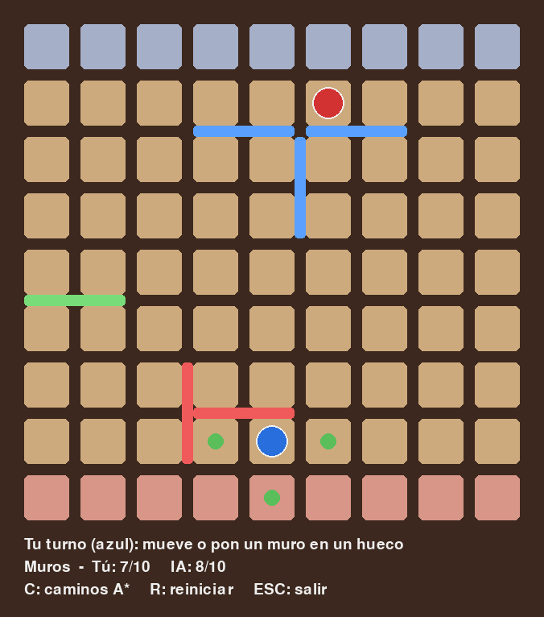

# Quoridor con IA (Minimax + poda alfa-beta + A*)

Juego de **Quoridor** en Python con **pygame**: juegas tú (azul) contra una IA (rojo).



## Cómo jugar

```bash
pip install -r requirements.txt
python main.py
```

**Objetivo:** llevar tu peón a la fila del otro lado (tú empiezas abajo y vas arriba; la IA al revés).
Al terminar aparece en grande quién ha ganado.

En tu turno haces **una** de estas dos cosas:

- **Mover el peón** una casilla (arriba, abajo, izquierda o derecha): haz clic en una casilla marcada en verde.
  Si el rival está al lado, puedes saltar por encima; si detrás hay un muro, saltas en diagonal.
- **Poner un muro** (tienes 10): pasa el ratón por un hueco entre casillas y haz clic.
  La vista previa sale en verde si el muro es válido y en gris si no.
  Tus muros se pintan en azul y los de la IA en rojo.
  Un muro no puede solaparse con otro ni dejar a nadie sin camino hasta su meta.

| Tecla | Acción |
|-------|--------|
| `C`   | Mostrar u ocultar los caminos más cortos (A*) de cada jugador |
| `R`   | Reiniciar la partida |
| `ESC` | Salir |

## Estructura del código

Solo tres archivos y ninguna clase: la partida es un diccionario y las reglas son funciones.

| Archivo      | Qué hace |
|--------------|----------|
| `main.py`    | Interfaz con pygame: dibuja el tablero y lee el ratón y el teclado. |
| `tablero.py` | Reglas del juego (peones con saltos, muros) y el algoritmo **A\***. |
| `minimax.py` | La IA: **Minimax con poda alfa-beta**. |

El estado de la partida es un diccionario que nunca se modifica (cada jugada crea uno nuevo):

```python
{'peones': [(8, 4), (0, 4)],         # casilla de cada jugador: [tú, IA]
 'muros': {('h', 3, 4): 0},          # muros puestos -> quién lo puso
 'muros_restantes': [10, 10],
 'turno': 0}                         # 0 = tú, 1 = IA
```

## Cómo piensa la IA

### A*

Busca el camino más corto desde un peón hasta su fila meta. Usa como heurística
el número de filas que faltan (nunca sobreestima, así que el camino encontrado es el más corto).
Se usa para:

1. **Validar muros**: un muro solo es legal si después los dos jugadores siguen teniendo camino.
2. **Evaluar posiciones**: lo que importa es cuántos pasos le faltan a cada uno.

Lleva `@lru_cache`, así que Python recuerda los resultados y la misma búsqueda no se repite.

### Minimax con poda alfa-beta

La IA simula las jugadas 4 turnos hacia delante (`PROFUNDIDAD`) suponiendo que tú también
juegas lo mejor posible, y elige la jugada con mejor resultado. La poda alfa-beta descarta
ramas que no pueden cambiar la decisión: da el mismo resultado pero mucho más rápido.

**Función de evaluación** (positiva = buena para la IA):

```
10 * (tus_pasos_hasta_meta - pasos_de_la_IA) + 5 * (muros_IA - tus_muros)
```

Que cada muro guardado valga 5 hace que la IA no los gaste pronto y los reserve para cuando
estás a punto de llegar. En las pruebas fue el valor que más partidas ganaba (probados 1, 3, 5, 8 y 12).

**Jugadas que prueba** (no todas, solo las que tienen sentido):

- Los movimientos del peón que lo acercan a su meta (si ninguno lo acerca, todos). Sin este filtro,
  la IA podía quedarse yendo y viniendo entre dos casillas por miedo a un muro que nunca llegaba.
- Solo los muros que cortan tu camino más corto (calculado con A*). Hay hasta ~130 muros posibles,
  pero los demás no te retrasan, y así el árbol de búsqueda es mucho más pequeño.

`jugadas_a_probar` usa `yield`: cada jugada se comprueba solo cuando el minimax la pide, así que
lo que descarta la poda alfa-beta ni se llega a calcular.

### Dificultad

Con `PROFUNDIDAD = 4` y `PESO_MUROS = 5` la IA tarda unos 15 ms de media por jugada (algo más de
1 s en las más complicadas). Para hacerla más fácil, pon `PROFUNDIDAD = 2` en `minimax.py`.
